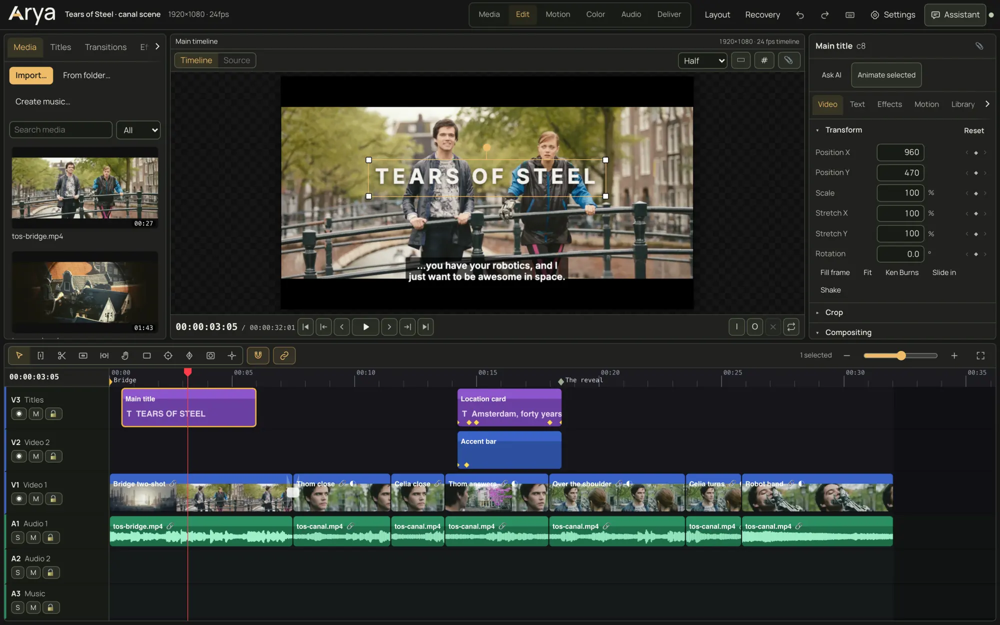
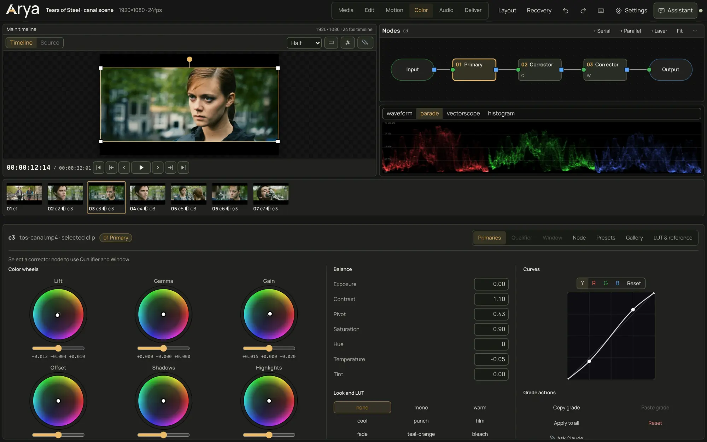
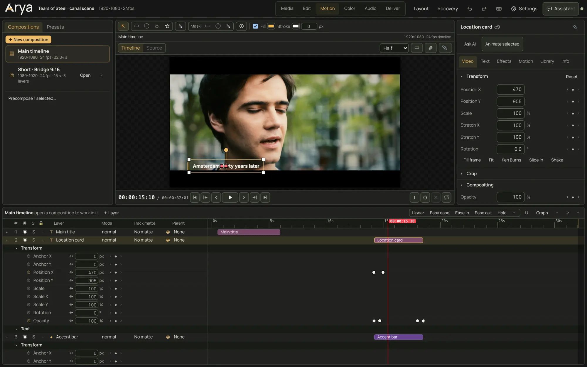
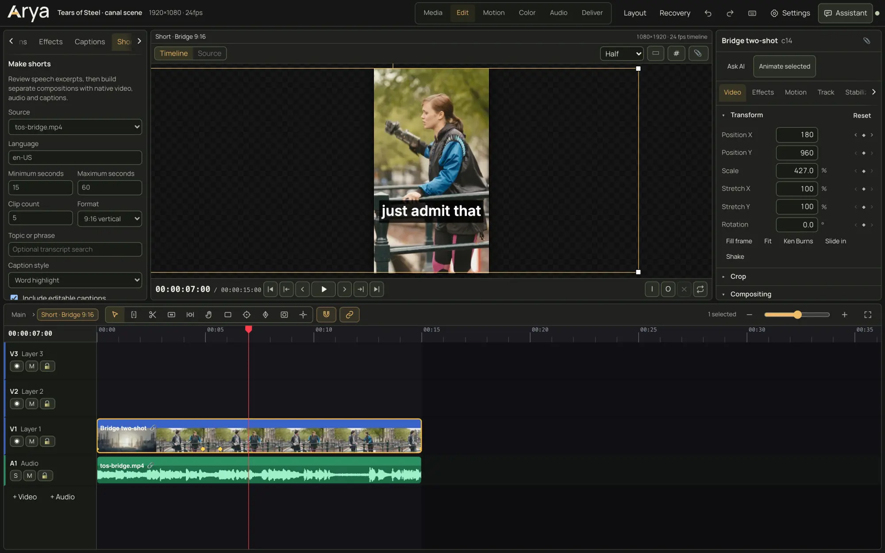

<p align="center">
  <picture>
    <source media="(prefers-color-scheme: dark)" srcset="site/assets/brand/wordmark.svg">
    <source media="(prefers-color-scheme: light)" srcset="site/assets/brand/wordmark-ink.svg">
    
  </picture>
</p>

<p align="center"><strong>Your edit. Every layer.</strong></p>

<p align="center">
  <a href="LICENSE"></a>
  
  <a href="https://github.com/rubix-labs-hq/arya/releases/latest"></a>
</p>

<p align="center">
  <a href="https://arya-beta-delta.vercel.app">Website</a> ·
  <a href="https://github.com/rubix-labs-hq/arya/releases/latest">Download for Mac</a> ·
  <a href="https://arya-beta-delta.vercel.app/editor/">Browser editor</a> ·
  <a href="docs/README.md">Docs</a>
</p>

Arya is an open-source video and motion editor. Cut, grade, animate, mix and make shorts in one project. Edit by hand on a timeline, or tell an AI assistant what should change. The assistant edits the same project you do, so every change is an ordinary edit you can see, adjust and undo.

Arya runs as a native SwiftUI and Metal app for Mac, and as a browser editor. You can run the browser editor from source with a local media server and a Claude Code plugin, or try a hosted version with fewer features. All of them use the same project format and editing operations. iPad and iPhone versions are coming later.

<p align="center">
  
</p>

<table>
  <tr>
    <td width="33%"></td>
    <td width="33%"></td>
    <td width="33%"></td>
  </tr>
  <tr>
    <td align="center">Color</td>
    <td align="center">Motion</td>
    <td align="center">Shorts</td>
  </tr>
</table>

<sub>Captures of the Arya browser editor, development build. Footage: <em>Tears of Steel</em>, (CC) Blender Foundation, <a href="https://mango.blender.org/">mango.blender.org</a>, licensed <a href="https://creativecommons.org/licenses/by/3.0/">CC BY 3.0</a>. The native app does not expose every feature shown here yet.</sub>

## Features

**Edit**
- Blade, ripple, roll, slip and slide on a multitrack timeline.
- Snapping, markers, automatic proxies and nested compositions.
- Multicam with audio sync for up to nine angles.
- Import and export FCPXML, OpenTimelineIO, SRT and WebVTT. Export CMX 3600 EDL from the browser editor.
- Export H.264, HEVC, ProRes 422, 422 HQ and 4444, GIF, PNG sequences, WAV and AAC from a render queue.

**Color**
- A node graph with serial, parallel and layer-mixer nodes.
- Lift, gamma, gain and offset wheels, curves, HSL qualifiers and circle, rectangle or linear windows.
- `.cube` LUTs and grade copy across clips.
- Waveform, RGB parade, vectorscope and histogram.

**Motion**
- Keyframes with easing presets and value and speed graphs.
- Expressions such as `wiggle(2, 30)`, parenting, masks, alpha and luma track mattes and precompose.
- Shapes, titles and nine title animations. Titles and shapes stay vector layers.
- A point and box tracker that can drive a layer, a mask or a color window. There is no planar tracker.

**Audio**
- Per-track fader, pan and an effect rack: parametric EQ, compressor, gate, de-esser, limiter, reverb and delay.
- Denoise and voice cleanup.
- Loudness measurement in LUFS and true peak, and clip normalization to -14, -16 or -23 LUFS.

**Shorts and transcript**
- Transcribe speech, correct any word and select passages by length or topic.
- Suggestions quote the transcript lines they come from. Their scores rank structure only and do not predict views.
- Each short is its own editable 9:16, 1:1 or 16:9 composition with linked audio and captions.
- Caption styles: plain, boxed, word highlight and one word at a time.
- Reframe with editable position keyframes.
- Transcription uses whisper.cpp in the browser editor and Apple speech recognition in the native app.

**Figma import**
- Import a frame with your own Figma access token in the Mac app or local editor. The Claude Code plugin can also import frame data supplied by the Figma MCP server; the Mac app accepts pasted MCP data.
- Text, rectangles, ellipses and nested frames arrive as editable layers. Other layers arrive as rendered images.
- Smart Animate turns two frames into an animated transition.
- Public Figma sign-in is not available yet. See [Figma account connection](docs/figma-account-setup.md).

**AI assistant**
- Select clips, a title or a range and say what should change.
- The assistant reads the project, can look at rendered frames and edits through the same operations as the timeline. Undo reverses its edits.
- Connect your own Claude Code, Codex or Google Gemini (beta) account through the provider's official sign-in. Arya includes no AI credits.
- Optional. Editing and export never need an assistant.

### Where each feature runs

The Mac app and the local browser editor share the same project format and editing operations. The hosted browser editor runs entirely in your browser, with no server, so it leaves out anything that needs ffmpeg, a speech model or an agent CLI.

| | Mac app | Browser editor, run locally | Hosted browser editor |
| --- | --- | --- | --- |
| Timeline editing, color, motion, audio mixing | Yes | Yes | Yes |
| Track matte controls, render queue | Not yet (mattes render) | Yes | Yes |
| Export formats | H.264, HEVC, ProRes, GIF, PNG, WAV, AAC | H.264, HEVC, ProRes, GIF, PNG, WAV, AAC | H.264, HEVC, WAV, AAC, up to 5 minutes |
| Transcription, captions and shorts | Yes (Apple speech) | Yes (whisper.cpp) | No |
| Loudness metering and normalization | Yes | Yes | Yes |
| Denoise, voice cleanup, multicam sync | Yes | Yes | No |
| FCPXML, OpenTimelineIO, SRT, WebVTT | Yes | Yes | No |
| CMX 3600 EDL export | No | Yes | No |
| Figma import | Yes | Yes | No |
| AI assistant | Yes | Yes | No |
| Where projects live | A folder you choose | A folder you choose | This browser's storage. Use backups. |

## Get Arya

| Option | Status |
| --- | --- |
| **Mac app** | Download the notarized DMG from [GitHub Releases](https://github.com/rubix-labs-hq/arya/releases/latest). Requires macOS 14 or newer, Apple silicon or Intel. Free. |
| **Browser editor** | Try the hosted editor at [arya-beta-delta.vercel.app/editor](https://arya-beta-delta.vercel.app/editor/) in current Chrome or Edge. It has no assistant, transcription, captions, Figma or interchange (see [Where each feature runs](#where-each-feature-runs)). For everything, run it locally (see below). |
| **iPhone, iPad and Mac App Store** | Coming later. |
| **Build from source** | See [Quick start for developers](#quick-start-for-developers). |

Arya is free. Optional contributions are being set up on the [support page](https://arya-beta-delta.vercel.app/support/).

## Quick start for developers

Arya was called Reel during development. The Claude Code command (`/reel`), the project file (`reel.project.json`), the `ReelKit` module, the Xcode project and the bundle identifiers keep that name until a tested migration exists.

### Prerequisites

- macOS 14 or newer
- Node.js 22 or newer
- ffmpeg and ffprobe on the `PATH` (`brew install ffmpeg`)
- Google Chrome (headless Chrome renders browser exports and frame snapshots)
- Xcode Command Line Tools (`xcode-select --install`) to build the local persistence helper
- Xcode 26.4.1 or newer for the native app
- Optional: whisper.cpp for browser transcription (`brew install whisper-cpp`, model in `~/.reel/models/ggml-base.en.bin`)

### Install

From the repository root:

```bash
npm ci --prefix editor
npm run --prefix editor prepare:persistence
npm run --prefix editor check:persistence
```

The preparation step builds the project file writer for arm64 and x86_64, signs it ad hoc and records its hash. Saves fail closed if the helper is missing or changed. Other operating systems do not have a supported writer yet.

### Run the browser editor

```bash
node editor/server.mjs --root /path/to/your/project --port 4870
```

Then open `http://127.0.0.1:4870/`. Any empty folder works as a project root. Arya creates `reel.project.json` in it on first save.

### Use the Claude Code plugin

```bash
claude --plugin-dir /path/to/arya
```

In Claude Code, `/reel` opens the editor for the project in the current folder. `/reel off` stops the server and turns the tools off.

### Build the native app

Run the install step above first. The native build copies the web editor and its packages from `editor/node_modules`.

Open `native/Reel.xcodeproj` in Xcode, or build and launch the Mac app from the command line:

```bash
./script/build_and_run.sh --verify
```

The Xcode project includes Mac, iPad and iPhone targets. The `Reel` scheme builds the Mac app and the `Reel iOS` scheme builds the iPhone and iPad app. To build for the iOS Simulator from the command line:

```bash
xcodebuild -project native/Reel.xcodeproj -scheme "Reel iOS" -destination 'generic/platform=iOS Simulator' -derivedDataPath build/DerivedData build
```

Install the result from `build/DerivedData/Build/Products/Debug-iphonesimulator/Arya.app` with `xcrun simctl install`. A physical iPhone or iPad needs your own signing team in Xcode. Its build phase bundles the shared JavaScript core, the web editor, fonts and third-party notices. `native/project.yml` is the XcodeGen source if the project needs regenerating. See [Native builds and distribution](docs/native-release.md).

### Run the tests

```bash
# Browser editor and server
npm test --prefix editor
npm run --prefix editor renderer:regressions
npm run --prefix editor processing:smoke
npm run --prefix editor golden

# Website
npm test --prefix site

# Third-party notices
node --test scripts/test-third-party-notices.mjs
node scripts/check-third-party-notices.mjs

# Native package
NODE="$(command -v node)" swift test --package-path native/ReelKit

# Release tooling
python3 native/scripts/test-release.py

# Claude Code plugin
claude plugin validate .
claude plugin test .
```

`python3 native/scripts/verify-arya-local.py --list` lists the phases of the serial local verifier. It runs the selected checks in a separate source copy and records the results under `build/local-verification`.

Type-checking the plugin needs the Claude Code API declarations. Run `/plugin-types` in a Claude Code session to write them to `.claude/types`, then run `npx tsc -p .`.

## Architecture

| Path | What it is |
| --- | --- |
| `editor/core/` | The project format and every edit operation (`project.js`), plus the expression language (`expr.js`). Plain JavaScript shared by the server, the browser and the native app. |
| `editor/server.mjs` | Local media server. Owns `reel.project.json`, serves media, makes filmstrips, waveforms and proxies with ffmpeg, and runs analysis and export jobs. |
| `editor/web/` | The browser editor: WebGL2 compositor, Web Audio mixer and Preact UI with Media, Edit, Motion, Color, Audio and Deliver pages. |
| `editor/agent/` | Adapters and the paired local companion for Claude Code, Codex and configured custom agents. |
| `.claude-plugin/`, `hooks/`, `types/`, `tests/` | The Claude Code plugin: `/reel` command, `mcp__reel__*` tools, the chat bridge and a launcher pane. |
| `native/` | SwiftUI editor, Metal compositor, ReelKit backend, native audio and Vision processing, Speech transcription, Figma connection and assistant. |
| `script/` | `build_and_run.sh` builds and opens the Mac app. |
| `scripts/` | Repository checks, including the third-party notices check. |
| `site/` | The static website. |
| `docs/` | Project format, build, release and design documents. |

The native app has its own assistant connection and exports without the Node server. iPhone and iPad can connect to an explicitly configured HTTPS companion. They cannot run desktop CLIs locally.

## Security model

The local server listens on 127.0.0.1 only. It refuses writes from other web origins and requests addressed to any other host name. Requests a browser marks as cross-site are refused, except opening the editor page or Figma's sign-in callback in a tab. Media reads stay inside the project folder or reach a media file the project points to. Project files are served with a sandbox policy, so an HTML or SVG file in a project cannot run as the editor. Expressions run in Arya's own small language, never as JavaScript, so opening a shared project cannot run code.

To report a vulnerability, see [SECURITY.md](SECURITY.md).

## Documentation

- [Docs index](docs/README.md)
- [Project format and backend API](docs/format.md)
- [Native builds and distribution](docs/native-release.md)
- [Mac distribution and installation](docs/arya-distribution.md)
- [Native roadmap](docs/native-roadmap.md)
- [Subscription agent bridge](docs/subscription-agent-bridge.md)
- [Assistant accounts and model routing](docs/assistant-routing.md)
- [Figma account connection](docs/figma-account-setup.md)
- [Website](site/README.md)

## Contributing, support and security

- [Contributing guide](CONTRIBUTING.md)
- [Support](SUPPORT.md): use [GitHub Issues](https://github.com/rubix-labs-hq/arya/issues) for bugs and questions.
- [Security policy](SECURITY.md): report vulnerabilities privately through [GitHub](https://github.com/rubix-labs-hq/arya/security/advisories/new).
- [Code of conduct](CODE_OF_CONDUCT.md)
- [Data guide](https://arya-beta-delta.vercel.app/privacy/)

## License

Arya is an open-source project by Rubix Labs. Its code is released under the [MIT License](LICENSE). Dependencies, fonts and media keep their own terms. See [THIRD_PARTY_NOTICES.md](THIRD_PARTY_NOTICES.md).
